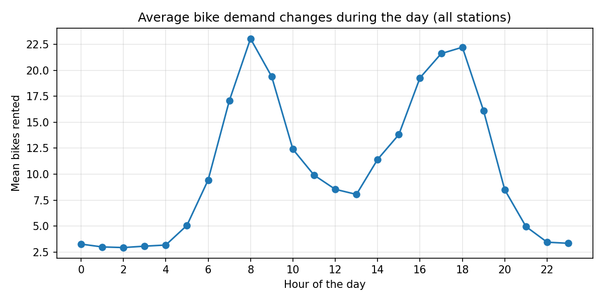
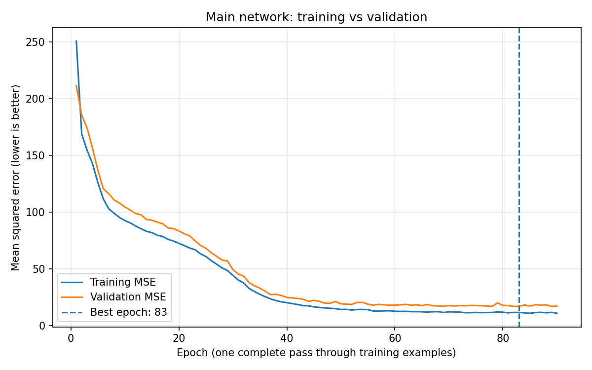
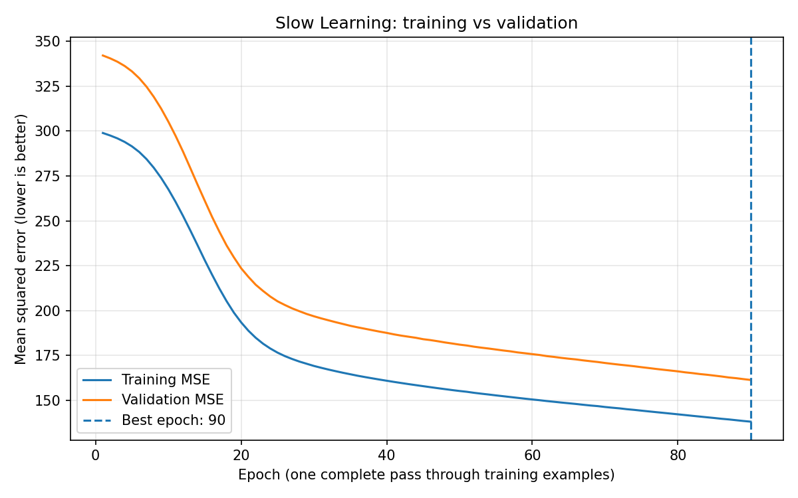
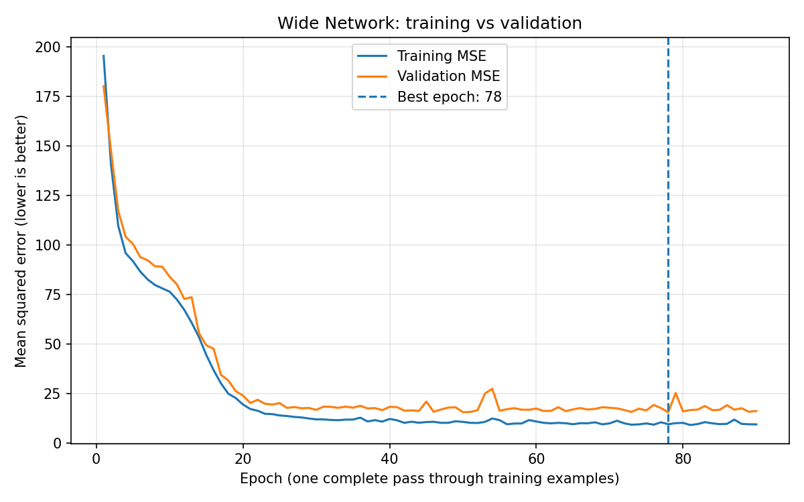

# Lakeshore Bike Demand

## What it does

Lakeshore Bike Share wants to guess how many bikes people will rent **next hour**. This project trains a small PyTorch neural network to make that guess from the hour, weather, weekend flag, and station type. It checks whether the network beats two simpler methods instead of assuming that fancy AI is automatically best.

Imagine I am practicing math problems. The model guesses, checks its mistake, and makes a small change before trying again. This repeated practice is the **training loop**.

## How to run it

Use Python 3.12. From inside this project folder:

```bash
conda env create -f environment.yml
conda activate aigc-5005-module07-torch
python train.py
python -m ruff format --check .
python -m ruff check .
python -m pytest
```

Or, if you prefer a Python virtual environment instead of conda:

```bash
python -m venv .venv
# Windows: .venv\Scripts\activate
# Linux or macOS: source .venv/bin/activate
python -m pip install -r requirements-dev.txt
python train.py
python -m pytest
```

The **single command** `python train.py` recreates every file in `reports/`. The submitted reports are already included so your instructor can inspect them without running code. The tests do not require any external data or internet access.

## Data and split

- **Data source:** `bikes_data.py` is the **professor provided generator**, with its calculation logic unchanged. `make_rentals()` makes 6,000 invented station-hour rows with seed 2026.
- **Inputs:** hour, temperature in Celsius, rainfall in mm, wind speed in kph, weekend (yes/no), and station type (downtown/residential/park).
- **Target:** `rentals`, the number of bikes rented in that hour.
- **Split:** 3,600 rows (60%) for training; 1,200 (20%) for validation; 1,200 (20%) for test. We split **before** preparing the features and use split seed 42.
- **No cheating:** StandardScaler learns the typical amounts from training rows **only**. OneHotEncoder learns the station labels from training rows **only**. Validation and test are just transformed using those training rules.

A **tensor** is a tidy box of numbers. `BikeDataset` gives the network one row at a time as `float32` tensors. A `DataLoader` groups rows into **batches** (small study groups). Only the training batches shuffle.



The average demand changes nonlinearly over the day. Busy and quiet hours create bumps, not one straight line; station type and weather further change the pattern. That makes a plain linear regression an imperfect match.

## Model and training

The main network is `8 inputs → 32 neurons → ReLU → 32 neurons → ReLU → 1 output`. The last output is an unrestricted number (no sigmoid), because **bike counts aren't probabilities**. For the wider experiment, both hidden layers have 128 neurons. Both networks satisfy the lab's requirement of **at least two hidden layers**.

- **Loss function:** mean squared error (MSE), which gives bigger mistakes a bigger penalty.
- **Optimizer:** Adam with a learning rate of 0.003 for the main run.
- **Batch size:** 64 examples at a time.
- **Epochs:** 90, meaning the network studies the full training pile 90 times.
- **Seeds:** NumPy, Python, PyTorch, and the training DataLoader have fixed seeds. This makes runs repeatable on the same machine.
- **Correct loop:** `optimizer.zero_grad()` clears old gradient information; `loss.backward()` calculates how to change the weights; `optimizer.step()` actually changes them.
- **Validation:** after every epoch, check the validation loss **without changing** the weights. Keep a copy of the weights from the lowest validation loss and restore them afterward.
- **Model choice:** compare experiment runs using validation MSE only. Look at the test data only after selecting the winner.

**Important words:** A *weight* is a learnable number; a *forward pass* is the model's guess; *loss* is how wrong that guess is; an *epoch* is one full round of study; *MAE* means the average absolute mistake measured in **bikes**.

## Results

Smaller errors are better. MAE of 2.42 means the model's guesses miss by **about 2.42 bikes on average**, not that every guess is within 2.42 bikes.

| Model | Validation MAE (bikes) | Test MAE (bikes) |
|---|---:|---:|
| Training mean (guess the same count every time) | 10.154 | 9.649 |
| Linear regression (straight-line approach) | 9.317 | 8.573 |
| **Selected neural network (wider network)** | **2.571** | **2.425** |

The neural network has the lowest MAE on both sets in this run. The linear model does a little better than the training mean but struggles with the two busy commute-time peaks and other curved relationships. The network can learn curved patterns with its ReLU layers, so it predicts these invented data more accurately.



The blue training line falls as the network gets better on examples it studies. The orange validation line also falls, then fluctuates; the dotted line shows the epoch with the best validation MSE (**epoch 82** for the main run). Choosing the minimum validation error avoids keeping a worse later version.

## Experiments

Only **one change** is made in each experiment, compared with the main run.

| Run | Changed setting | Best epoch | Best validation MAE (bikes) | Final train MSE | Final validation MSE |
|---|---|---:|---:|---:|---:|
| Main | 32 hidden neurons, learning rate 0.003 | 82 | 2.725 | 10.945 | 17.269 |
| Slow learning | Learning rate **0.0001** | 90 | 8.332 | 138.193 | 161.405 |
| Wider network | Hidden width **128** | 78 | **2.571** | 9.250 | 16.272 |

**What we learned:** The tiny learning rate is **underfitting** within 90 epochs: it changes the weights too slowly and leaves large errors. The wider network learns the more complicated demand pattern and has the **best validation MSE (15.433)**, so it is the selected network. Its final validation loss being slightly worse than its best loss shows why we must **restore the best weights** rather than keep the last ones. Training loss being lower than validation loss is a normal generalization gap; these runs do not provide enough evidence to declare severe overfitting.

Each run also has its own saved graph:





The full numbers (including both baselines' MSE) are in `reports/metrics.json`. All epoch-by-epoch numbers are in `reports/history.csv`, and the three-run comparison is in `reports/experiments.csv`.

## Limitations

This is **made-up learning data**, not real Lakeshore Bike Share records. Real demand can also depend on holidays, school breaks, sporting events, bike availability, maintenance, and sudden local events, which are not included. The model predicts a typical count and cannot promise an exact number, explain cause and effect, or guarantee enough bikes for every rider. Planners should **not** treat its guesses as a safety guarantee or replace real-world checks with them. Test performance on real collected data before using predictions to move actual bikes.

